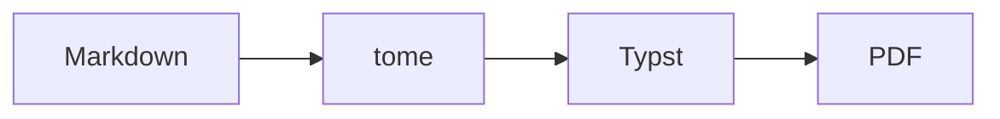

## Headings

### Level 3 heading

#### Level 4 heading

##### Level 5 heading

## Inline formatting

Text with **bold**, _italic_, ~~strikethrough~~, `inline code`, and a
[link to Typst](https://typst.app). Superscript: 15<sup>th</sup>; subscript:
CO<sub>2</sub>.

A hard line break follows this line.\
This is the next line.

---

## Lists

- First bullet with **bold text**
  - Nested bullet with _italic text_
    1. Numbered sub-item with `inline code`
    2. Another numbered sub-item
  - Another nested bullet
- Second bullet

1. First numbered item
   - Nested bullet under a numbered item
   - Another nested bullet
2. Second numbered item
   1. Nested numbered item
   2. Another nested numbered item
3. Third numbered item

- [x] Completed task
- [ ] Open task

## Quotes and alerts

> A normal blockquote remains a normal blockquote.

> [!NOTE]
> Background information people should see, even when skimming.

> [!TIP]
> An optional shortcut or a better way to do something.

> [!IMPORTANT]
> Something people must know or do to succeed.

> [!WARNING]
> Something that needs attention right now to avoid problems.

> [!CAUTION]
> A risky action, like one that deletes data or cannot be undone.

## Tables

| Feature  | Expected         | Status |
| :------- | :--------------- | -----: |
| Headings | Render           |   Done |
| Lists    | Render           |   Done |
| Tables   | Render           |   Done |
| Alerts   | Styled blocks    |   Done |
| Code     | Render           |   Done |
| Mermaid  | Rendered diagram |   Done |
| Images   | Render           |   Done |
| Sup/sub  | Render           |   Done |

## Code

```python
def hello(name: str) -> str:
    return f"hello {name}"

print(hello("tome"))
```

## Mermaid



## Image


